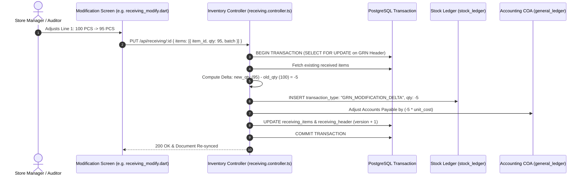

# Developer Guide: Operations Document Modification & Differential Ledger Architecture

This technical guide documents the backend transactional logic, differential stock ledger adjustment algorithm, concurrency row locking, and tax group recalculation routines used by the document modification controllers.

---

## 📑 Table of Contents
1. [Differential Modification Sequence Diagram](#1-differential-modification-sequence-diagram)
2. [Target Controllers & Modification Endpoints](#2-target-controllers--modification-endpoints)
3. [The Differential Stock Ledger Adjustment Algorithm](#3-the-differential-stock-ledger-adjustment-algorithm)
4. [Concurrency Controls & Row Locking (`SELECT FOR UPDATE`)](#4-concurrency-controls--row-locking-select-for-update)
5. [Automatic Tax Group Recalculation Engine](#5-automatic-tax-group-recalculation-engine)

---

## 1. Differential Modification Sequence Diagram

When an approved inventory document (such as a GRN or Stock Issue) is modified, the backend calculates deltas rather than wiping the audit trail:



---

## 2. Target Controllers & Modification Endpoints

The four modification screens interact with the following REST endpoints:

| Screen | Target Controller | REST Endpoint | Database Models Affected |
| :--- | :--- | :--- | :--- |
| `purchase_modify.dart` | `purchaseOrder.controller.ts` | `PUT /api/purchase-orders/:id` | `purchase_orders`, `purchase_order_items` |
| `receiving_modify.dart` | `receiving.controller.ts` | `PUT /api/receiving/:id` | `receiving_header`, `receiving_items`, `stock_ledger`, `accounts_payable` |
| `request_modify.dart` | `request.controller.ts` | `PUT /api/inventory/request/:id` | `request_header`, `request_items` |
| `stock_out_modify.dart` | `issue.controller.ts` | `PUT /api/inventory/issue/:id` | `issue_header`, `issue_items`, `stock_ledger` |

---

## 3. The Differential Stock Ledger Adjustment Algorithm

To preserve historical audit integrity and prevent database corruption:

```typescript
// Pseudocode for Differential Stock Adjustment
for (const newItem of req.body.items) {
    const oldItem = existingItems.find(it => it.item_id === newItem.item_id);
    const oldQty = oldItem ? Number(oldItem.qty) : 0;
    const newQty = Number(newItem.qty);
    const delta = newQty - oldQty;

    if (delta !== 0) {
        if (delta > 0) {
            // Surplus stock added to receiving
            await db.models.stock_ledger.create({
                outlet_id,
                item_id: newItem.item_id,
                transaction_type: 'GRN_REVISION_IN',
                qty_in: delta,
                reference_id: `GRN-${grnId}-REV`,
                remarks: `Revised received quantity from ${oldQty} to ${newQty}`
            }, { transaction: t });
        } else {
            // Shortage stock deducted from receiving
            await db.models.stock_ledger.create({
                outlet_id,
                item_id: newItem.item_id,
                transaction_type: 'GRN_REVISION_OUT',
                qty_out: Math.abs(delta),
                reference_id: `GRN-${grnId}-REV`,
                remarks: `Revised received quantity from ${oldQty} to ${newQty}`
            }, { transaction: t });
        }
    }
}
```

---

## 4. Concurrency Controls & Row Locking (`SELECT FOR UPDATE`)

To ensure two supervisors cannot modify the same Purchase Order or GRN simultaneously:
1. Every modification endpoint initiates a database transaction `t`.
2. The document header is queried using `lock: t.LOCK.UPDATE`.
3. If another process is modifying the document, the second query waits until transaction completion or throws a 409 Conflict after lock timeout.

---

## 5. Automatic Tax Group Recalculation Engine

When line item quantities or prices change:
1. The controller resolves each item's linked `tax_group_id`.
2. Computes the composite tax rate (e.g. CGST 9% + SGST 9% = 18%).
3. Evaluates price inclusiveness (`is_inclusive_tax` flag).
4. Updates taxable subtotal, tax breakdown JSON, and net payable before saving.
