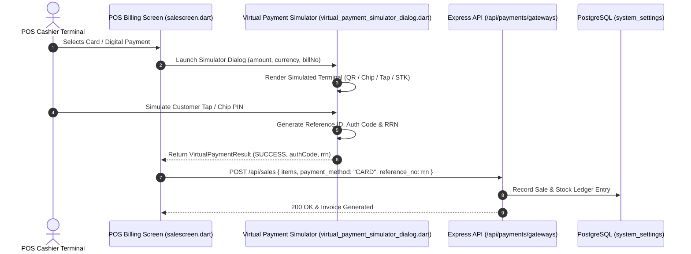

# Developer Guide: Multi-Gateway Architecture & Payment Simulation Engine

This technical guide documents the backend gateway configuration store, secret masking protocol, webhook handling, and the client-side **Virtual Payment Simulator** state machine.

---

## 📑 Table of Contents
1. [Architectural Overview & Sequence Diagram](#1-architectural-overview--sequence-diagram)
2. [Database Schema & Secret Protection](#2-database-schema--secret-protection)
3. [REST API Endpoints Reference](#3-rest-api-endpoints-reference)
4. [Client-Side Simulator State Machine (Flutter)](#4-client-side-simulator-state-machine-flutter)
5. [POS Checkout Integration & Ledger Reconciliation](#5-pos-checkout-integration--ledger-reconciliation)

---

## 1. Architectural Overview & Sequence Diagram

The payment subsystem decouples payment method execution from invoice creation. The POS checkout engine can accept tokens and transaction references from live third-party gateways or the virtual simulation engine.



---

## 2. Database Schema & Secret Protection

### Storage in `system_settings`:
Payment gateway credentials are encrypted or stored in `system_settings.custom_settings.payment_gateways`:

```json
{
  "payment_gateways": {
    "upi": {
      "enabled": true,
      "upi_id": "merchant@bank",
      "payee_name": "Retail Store",
      "print_upi_qr": true
    },
    "razorpay": {
      "enabled": true,
      "env": "test",
      "key_id": "rzp_test_xxxx",
      "key_secret": "encrypted_secret"
    },
    "stripe": {
      "enabled": true,
      "env": "test",
      "publishable_key": "pk_test_xxxx",
      "secret_key": "encrypted_secret"
    },
    "square": {
      "enabled": false,
      "env": "sandbox",
      "app_id": "sq0idp-xxxx",
      "location_id": "LXXXX",
      "access_token": "encrypted_token"
    },
    "mpesa": {
      "enabled": true,
      "env": "sandbox",
      "type": "till",
      "shortcode": "174379",
      "consumer_key": "xxxx",
      "consumer_secret": "xxxx",
      "passkey": "xxxx"
    }
  }
}
```

### Masking Protocol:
To avoid exposing sensitive private keys and API tokens to the client browser or cashier logs, `paymentGateways.controller.ts` masks all secrets when responding to `GET /api/payments/gateways/config`:

```typescript
// Masked response payload:
{
  "razorpay": {
    "enabled": true,
    "env": "test",
    "key_id": "rzp_test_xxxx",
    "key_secret": "********",
    "has_secret": true
  }
}
```
When updating (`POST /api/payments/gateways/config`), if `key_secret` is `********` or empty, the backend preserves the existing persisted secret without overwriting it.

---

## 3. REST API Endpoints Reference

### 1. `GET /api/payments/gateways/config`
- **Auth**: Requires Bearer JWT (`auth.middleware`)
- **Query**: Automatically scopes to `req.user.outlet_id`
- **Response**:
```json
{
  "success": true,
  "data": {
    "settlement_mode": "DIRECT",
    "active_methods": [
      { "id": "CASH", "name": "Cash", "enabled": true },
      { "id": "CARD", "name": "Credit / Debit Card", "enabled": true },
      { "id": "UPI", "name": "UPI / QR Pay", "enabled": true }
    ],
    "upi": { "enabled": true, "upi_id": "store@upi", "payee_name": "Store" },
    "razorpay": { "enabled": true, "key_id": "rzp_test_...", "has_secret": true },
    "stripe": { "enabled": false, "publishable_key": "", "has_secret": false }
  }
}
```

### 2. `POST /api/payments/gateways/config`
- **Auth**: Admin or Manager role required
- **Body**: Updated JSON object matching gateway keys
- **Response**: `{ "success": true, "message": "Gateways configuration saved successfully." }`

---

## 4. Client-Side Simulator State Machine (Flutter)

The simulator is implemented in `lib/widgets/virtual_payment_simulator_dialog.dart`. It exposes a standardized invocation interface:

```dart
final result = await VirtualPaymentSimulatorDialog.show(
  context,
  amount: 450.00,
  initialMethod: 'CARD', // or 'UPI', 'MPESA'
  billNo: 'INV-2026-0041',
  upiId: 'merchant@upi',
  posDeviceName: 'PineLabs Android SmartPOS',
);

if (result != null && result.status == 'SUCCESS') {
  print('Transaction Ref: ${result.referenceId}');
  print('Approval Code: ${result.authCode}');
  print('RRN: ${result.rrn}');
}
```

### Data Contract (`VirtualPaymentResult`):
```dart
class VirtualPaymentResult {
  final String method;      // 'UPI', 'CARD', 'MPESA', 'STRIPE', etc.
  final double amount;
  final String referenceId; // Auto-generated TXN id
  final String? authCode;   // Bank 6-digit approval code
  final String? rrn;        // 12-digit Retrieval Reference Number
  final String? cardBrand;  // Visa, MasterCard, RuPay, Amex
  final String? last4;      // 4-digit card mask
  final String? phone;      // Mobile number for M-Pesa / UPI
  final String status;      // 'SUCCESS' | 'DECLINED'
  final String message;
  final DateTime timestamp;
}
```

---

## 5. POS Checkout Integration & Ledger Reconciliation

When `VirtualPaymentResult` is received by `salescreen.dart`:
1. `payment_modes` array records the breakdown:
   ```json
   {
     "method": "CARD",
     "amount": 450.00,
     "reference_no": "TXN-894719284712",
     "auth_code": "AUTH-4920",
     "rrn": "402910482910"
   }
   ```
2. The sales header records `payment_status = 'PAID'`.
3. In the accounting module, the transaction posts to `CashLedger` or `BankLedger` using the RRN as the external audit key.
