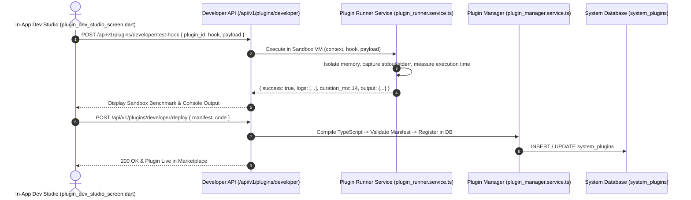

# Developer Guide: Plugin Dev Studio & Sandbox Execution Engine

This technical guide documents the internal architecture of the **Plugin Development Studio**, backend sandboxing, hook lifecycle dispatcher, and safe module execution on cloud platforms.

---

## 📑 Table of Contents
1. [Architecture & Hook Dispatch Sequence](#1-architecture--hook-dispatch-sequence)
2. [Plugin Runner & Cloud Deployment Safety](#2-plugin-runner--cloud-deployment-safety)
3. [Supported Lifecycle Hooks & Payload Specs](#3-supported-lifecycle-hooks--payload-specs)
4. [Sandbox Execution & Security Boundaries](#4-sandbox-execution--security-boundaries)
5. [Developer Studio REST Endpoints](#5-developer-studio-rest-endpoints)

---

## 1. Architecture & Hook Dispatch Sequence

Plugins execute in an isolated runtime context triggered synchronously or asynchronously by core system events:



---

## 2. Plugin Runner & Cloud Deployment Safety

### Render & Production Deployment Safeguards:
On platforms such as Render, Railway, or AWS Elastic Beanstalk where `NODE_ENV=production` typically skips `devDependencies`:
1. **TypeScript Production Dependency**: `typescript` is declared in `dependencies` (production) in `package.json` so the runtime can transpile developer TypeScript plugins on demand without failing with `Cannot find module 'typescript'`.
2. **Safe Dynamic Imports**: `backend/services/plugin_runner.service.ts` wraps dynamic script imports in try/catch blocks with fallbacks to avoid application crashes if user-submitted code contains runtime syntax errors.

---

## 3. Supported Lifecycle Hooks & Payload Specs

Developers can implement any of the following lifecycle hooks in their plugin module:

| Hook Name | Execution Timing | Arguments Passed | Purpose |
| :--- | :--- | :--- | :--- |
| `onInit` | When plugin loads or starts | `context` | Validate credentials, connect to external APIs, initialize state. |
| `onPaymentCreate` | When customer enters payment flow | `context`, `payload` (`amount`, `currency`, `receipt`) | Create third-party payment intent or mobile money prompt. |
| `onSaleComplete` | After sale is committed to database | `context`, `saleData` (`invoice_no`, `items`, `total_amount`) | Trigger external accounting sync, WhatsApp invoice, or loyalty points credit. |
| `onKotCreated` | When table order fires to kitchen | `context`, `kotData` (`table_no`, `items`, `waiter`) | Send notification to pager, kitchen buzzer, or external KDS. |
| `onInventoryDeduct`| When items leave stock ledger | `context`, `ledgerData` (`outlet_id`, `item_id`, `qty`) | Monitor critical stock levels and trigger vendor reorders. |

### Context Object Specification:
```typescript
interface PluginExecutionContext {
  outletId: number;
  outletName: string;
  userId: number;
  environment: 'sandbox' | 'production';
  logger: {
    info: (...args: any[]) => void;
    warn: (...args: any[]) => void;
    error: (...args: any[]) => void;
  };
  storage: {
    get: (key: string) => Promise<any>;
    set: (key: string, value: any) => Promise<void>;
  };
}
```

---

## 4. Sandbox Execution & Security Boundaries

To prevent unauthorized file system or process access:
- Plugins do not have access to `process.exit`, `child_process`, or raw host operating system filesystem commands.
- Network requests are routed through standard HTTP client wrappers with timeout thresholds (default 10,000 ms).
- If a hook execution exceeds the memory or execution time budget, the runner aborts the worker and flags the plugin in the admin dashboard.

---

## 5. Developer Studio REST Endpoints

### 1. `POST /api/v1/plugins/developer/test-hook`
Executes an isolated test run against a plugin without committing database state:
- **Body**:
```json
{
  "plugin_id": "plg_custom_warehouse_alert",
  "hook": "onSaleComplete",
  "payload": {
    "invoice_no": "INV-10928",
    "total_amount": 6200.00,
    "items": [{ "item_id": 12, "name": "Espresso Machine", "qty": 1 }]
  }
}
```
- **Response**:
```json
{
  "success": true,
  "execution_ms": 11,
  "logs": [
    "[INFO] Custom plugin loaded for outlet: 1",
    "[INFO] High-value sale detected: INV-10928"
  ],
  "result": { "notified": true }
}
```

### 2. `POST /api/v1/plugins/developer/deploy`
Publishes the plugin code to the outlet or global marketplace:
- **Body**: `{ "id", "name", "version", "category", "code", "language", "isPublic" }`
- **Response**: `{ "success": true, "message": "Plugin deployed successfully." }`

### 3. `GET /api/v1/plugins/marketplace`
Returns paginated marketplace listings with category filters, ratings, and verified developer badges.
