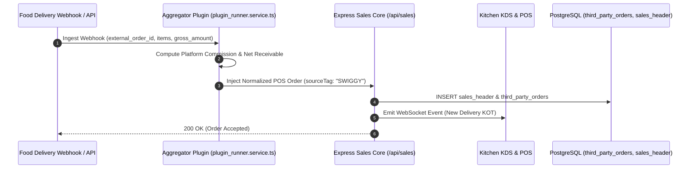
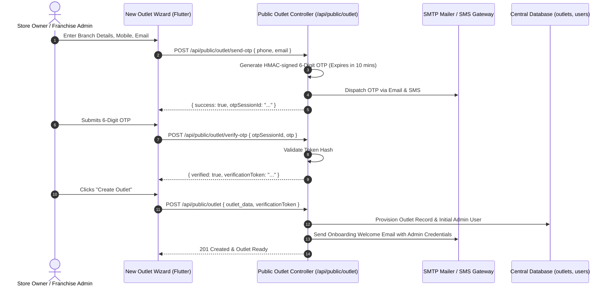

# Developer Guide: Third-Party Orders Engine & Outlet Onboarding OTP Architecture

This technical guide documents the aggregator order ingestion schema, commission calculation engine, phone/email OTP verification state machine, and the automated SMTP welcome dispatch workflow for new outlet provisioning.

---

## 📑 Table of Contents
1. [Aggregator Ingestion & Commission Architecture](#1-aggregator-ingestion--commission-architecture)
2. [Outlet Onboarding OTP State Machine](#2-outlet-onboarding-otp-state-machine)
3. [REST API Endpoints Reference](#3-rest-api-endpoints-reference)
4. [Email Dispatcher & Admin Provisioning](#4-email-dispatcher--admin-provisioning)
5. [Universal Text & Excel Export Pipeline](#5-universal-text--excel-export-pipeline)

---

## 1. Aggregator Ingestion & Commission Architecture

Third-party food delivery platforms (Zomato, Swiggy, UberEats) and B2B global distributor orders are normalized into a unified schema:



---

## 2. Outlet Onboarding OTP State Machine

To prevent unauthorized branch creation, outlet registration requires cryptographic two-step verification:



---

## 3. REST API Endpoints Reference

### 1. `GET /api/v1/plugins/reports/third-party-orders`
- **Auth**: Bearer JWT (`auth.middleware`)
- **Query Params**:
  - `outletId`: Integer
  - `sourceTag`: `ALL`, `ZOMATO`, `SWIGGY`, `UBEREATS`, `MARKETPLACE`
  - `startDate`, `endDate`: ISO8601 strings
  - `search`: String
- **Response**:
```json
{
  "success": true,
  "summary": {
    "total_gross": 48250.00,
    "total_commission": 8685.00,
    "total_net": 39565.00,
    "order_count": 128
  },
  "orders": [
    {
      "order_id": "ZOM-89210",
      "source": "ZOMATO",
      "customer_name": "John Doe",
      "gross_amount": 450.00,
      "commission_amount": 81.00,
      "net_amount": 369.00,
      "status": "DELIVERED",
      "created_at": "2026-10-11T14:32:00Z"
    }
  ]
}
```

### 2. `POST /api/public/outlet/send-otp`
- **Body**: `{ "phone": "+919876543210", "email": "store@example.com" }`
- **Response**: `{ "success": true, "otpSessionId": "sess_89218731" }`

### 3. `POST /api/public/outlet/verify-otp`
- **Body**: `{ "otpSessionId": "sess_89218731", "otp": "491823" }`
- **Response**: `{ "success": true, "verificationToken": "vtoken_928131" }`

---

## 4. Email Dispatcher & Admin Provisioning

When a new branch is created via `POST /api/public/outlet`, the controller invokes `sendOutletWelcomeEmail`:
```typescript
await mailerService.sendMail({
  to: outlet.admin_email,
  subject: `Welcome to Retail POS - Credentials for ${outlet.name}`,
  template: 'outlet_onboarding',
  context: {
    outletName: outlet.name,
    outletCode: outlet.outlet_code,
    username: adminUser.username,
    tempPassword: generatedPassword,
    loginUrl: `${process.env.APP_URL}/login`
  }
});
```

---

## 5. Universal Text & Excel Export Pipeline

To prevent corruption when exporting on Windows, Linux, and Android devices:
- Text files are exported with UTF-8 BOM encoding headers.
- Newlines are normalized to CRLF (`\r\n`) to preserve formatted column grids on legacy receipt printers and Windows Notepad.
