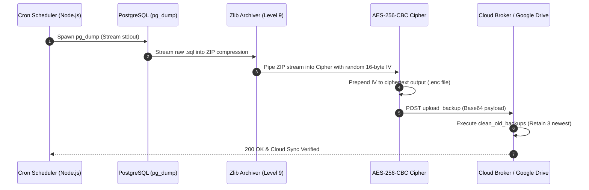
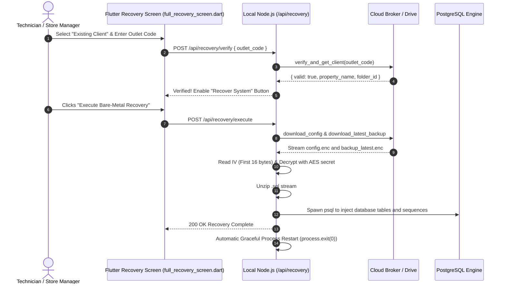

# 🛡️ Enterprise Disaster Recovery & Cloud Backup Documentation

**Module**: Secure Cloud Backup & Bare-Metal Restore System  
**Version**: 1.0.0  
**Target Environment**: Local POS, Franchise Outlets, Enterprise Cloud Hub  

---

## 📑 Table of Contents
1. [System Overview & Key Features](#1-system-overview--key-features)
2. [Cloud Backend (Google Apps Script / Cloud Broker)](#2-cloud-backend-google-apps-script--cloud-broker)
3. [Client Initialization & Sync Tracker Architecture](#3-client-initialization--sync-tracker-architecture)
4. [Automated Backup Pipeline & Encryption Lifecycle](#4-automated-backup-pipeline--encryption-lifecycle)
5. [Bare-Metal Restore Process (Disaster Recovery Workflow)](#5-bare-metal-restore-process-disaster-recovery-workflow)
6. [Operational Troubleshooting & Failure Modes](#6-operational-troubleshooting--failure-modes)

---

## 1. System Overview & Key Features

This subsystem provides an enterprise-grade, fully automated disaster recovery (DR) solution for local POS (Point of Sale) instances. It securely encrypts local PostgreSQL databases and configuration files, streams them to cloud storage via Google Workspace APIs, and provides a 1-click bare-metal restore interface via the Flutter client.

### Key Architectural Features:
- **AES-256-CBC Encryption**: All database backups are encrypted locally before transmission. The cloud only stores `.enc` ciphertext; cloud providers never possess the plaintext database or decryption keys.
- **Self-Healing State Tracker**: Uses a local write-ahead log (`sync_status.json`) to resume interrupted cloud setups after sudden power outages, internet loss, or hardware reboots.
- **Automated Retention Policy**: Google Drive automatically purges old backups, keeping only the 3 most recent snapshots to prevent storage bloat.
- **Blind Recovery**: In the event of catastrophic physical hardware failure, store technicians only need the **Outlet Code** to initiate an automated system rebuild.

---

## 2. Cloud Backend (Google Apps Script / Cloud Broker)

The cloud broker acts as a serverless API gateway between the local Node.js application and cloud storage:

| API Action Key | Purpose & Execution Logic |
| :--- | :--- |
| `verify_and_get_client` | Cross-references the provided Outlet Code against the central directory database and resolves the assigned Drive folder ID. |
| `upload_config` | Saves and atomically overwrites `config.enc` and `config.json` inside the outlet's private cloud storage folder. |
| `upload_backup` | Ingests Base64-encoded, AES-256 encrypted `.enc` database backups. |
| `clean_old_backups` | Scans the outlet's cloud folder, sorts backup files by date, and moves all but the 3 newest snapshots to trash. |
| `download_latest_backup` | Streams the most recent `.enc` database backup stream down to the local node for bare-metal restore. |
| `download_config` | Streams decrypted environment credentials and server configs down to a replacement PC. |

---

## 3. Client Initialization & Sync Tracker Architecture

When the POS starts up, the `initClient` routine guarantees the local machine is synchronized with cloud storage.

### The Write-Ahead Sync Tracker (`sync_status.json`):
To prevent duplicate Google Drive folder provisioning or infinite sync loops caused by unexpected server crashes:
- **Offline Resilience**: If an upload fails due to network downtime, the specific task flag (e.g. `config_synced`) remains `false`.
- **Next-Boot Resumption**: On the next startup, the engine reads `sync_status.json`, skips completed tasks (like folder creation), and immediately resumes only failed uploads.
- **Optimized Disk I/O**: Master credentials (`client.json`) are only written to physical storage if core identity values change, minimizing SSD write wear.

---

## 4. Automated Backup Pipeline & Encryption Lifecycle

Backups are executed by an automated background Cron job configured to run hourly (`0 * * * *`). A global lock (`isBackupJobRunning`) prevents overlapping backup runs.

### Encryption Pipeline Steps:
1. **Extract**: Node.js spawns `pg_dump` with streaming `stdout`, completely bypassing Node.js process RAM limits.
2. **Compress**: The `.sql` stream is piped directly into a high-compression `zlib` stream.
3. **Encrypt**: A cryptographically random 16-byte Initialization Vector (IV) is generated and prepended to the payload. The ZIP stream is transformed through an `aes-256-cbc` cipher.
4. **Rename**: The output file is named with an explicit timestamp (e.g. `backup_2026-10-11_21-00-01.enc`).
5. **Upload & Prune**: The `.enc` payload uploads to the cloud broker, followed immediately by `clean_old_backups`.

---

## 5. Bare-Metal Restore Process (Disaster Recovery Workflow)

If an in-store POS terminal suffers fatal hardware destruction (e.g., hard drive crash, liquid spill, lightning surge):

### Phase 1: Verification (Flutter UI)
1. Launch app on replacement machine and select **Existing Client Setup**.
2. Enter the registered **Outlet Code** (e.g. `RET_001`).
3. The system queries the cloud broker. Upon validation, the store name displays and unlocks the **Recover System** action.

### Phase 2: Autonomous Rebuild (Node.js Engine)
1. **Rebuild Identity**: `client.json` is recreated from verified cloud records.
2. **Restore Configurations**: `config.enc` and `config.json` are downloaded to restore database passwords and port configurations.
3. **Fetch Database Snapshot**: The latest encrypted `.enc` snapshot is downloaded.
4. **Decrypt & Unpack**: The first 16 bytes are extracted as the IV; the ciphertext is decrypted and unpacked into the clean `.sql` database stream.
5. **Re-Inject Database**: `psql` executes the stream to reconstitute all PostgreSQL relational tables, indexes, and document sequences.
6. **Graceful Restart**: Flutter confirms success to the operator, and the application service restarts cleanly into operational mode.

---

## 6. Operational Troubleshooting & Failure Modes

| Symptom | Probable Cause | Corrective Resolution |
| :--- | :--- | :--- |
| **Recovery dialog shows early, but database tables are empty.** | Node.js returned HTTP response before `psql` child process finished. | Ensure `res.json({success: true})` is placed strictly after the database import promise resolves. |
| **Application crashes in infinite restart loop.** | PM2 or Nodemon is watching `client.json` or `config.json` file writes. | Add `client.json`, `sync_status.json`, and `config.json` to process watcher `--ignore` configurations. |
| **Backup uploads successfully but file size is 0 KB.** | `pg_dump` failed due to invalid PostgreSQL credentials or empty schema. | Verify PostgreSQL connection credentials in `config.enc` and confirm the database service is running locally. |
| **Cloud storage folder has multiple duplicate configs.** | Missing overwrite flag during cloud upload. | Ensure the cloud broker executes a soft-delete / trash on existing `config.enc` before creating the replacement. |

---

*Document Source: `Docs/Disaster-Recovery-Documentation.md` | Verified 100% Markdown Native for GitHub Rendering*
